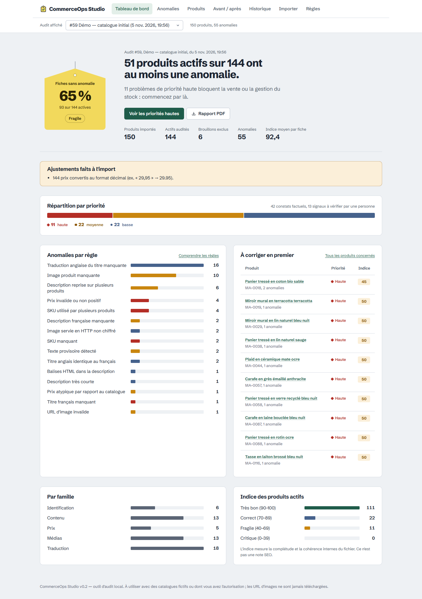

# CommerceOps Studio

**Audit de qualité de catalogue e-commerce : trouver ce qui bloque la vente, expliquer pourquoi, dire quoi corriger en premier.**

Application web locale (FastAPI + React/TypeScript) destinée aux agences e-commerce et aux équipes de boutique en ligne. On importe un export CSV du catalogue ; l'application détecte les anomalies (références, prix, contenus, images, traductions), les priorise, propose une correction pour chacune et mesure les progrès d'un import à l'autre.

> **Statut : v0.2, prototype de portfolio fonctionnel.** Toutes les fonctionnalités décrites ici sont implémentées et couvertes par des tests exécutés (voir [rapport v0.2](docs/RAPPORT_V0.2.md)). Les données de démonstration sont **100 % fictives**. Ce n'est pas un produit commercial durci pour Internet (pas d'authentification) : il est conçu pour tourner sur un poste local.



## Ce que l'application fait

| Besoin | Fonction |
|---|---|
| Importer un catalogue | CSV UTF-8, séparateur `,` ou `;` (export Excel FR), prix `29,95` ou `29.95`. Erreurs bloquantes **ligne par ligne** ; un fichier rejeté ne modifie rien. |
| Comprendre l'état du catalogue | Tableau de bord : part des fiches sans anomalie, répartition par priorité, par règle, par famille, produits à corriger en premier. |
| Traiter les anomalies | 19 règles explicites. Chaque anomalie a une **priorité**, un **constat**, une **explication** et une **correction suggérée**. Les 9 règles heuristiques sont marquées « À vérifier » : elles ne sont jamais présentées comme des certitudes. |
| Travailler en équipe | Filtres, recherche, tri et pagination, conservés dans l'URL (partageables) ; fiche produit avec le détail de son indice (`100 − 50 − 5 = 45`). |
| Rendre compte | Export CSV des anomalies (respecte les filtres, protégé contre l'injection de formules), export CSV des produits, **rapport PDF**. |
| Mesurer les progrès | Historique des audits et comparaison **avant / après** : anomalies résolues, nouvelles, persistantes, par règle et par priorité. |

### Démonstration mesurée

Avec les catalogues fictifs fournis (boutique imaginaire « Maison Ardoise ») :

| | Avant | Après corrections |
|---|---:|---:|
| Produits (actifs) | 150 (144) | 152 (146) |
| Anomalies | 55 | 9 (**−83,6 %**) |
| Priorité haute | 11 | 0 |
| Fiches actives sans anomalie | 65 % | 95 % |

49 anomalies résolues, 6 encore présentes (traductions en cours), 3 nouvelles (un produit ajouté incomplet). Ces chiffres proviennent de l'exécution réelle et sont vérifiés par `tests/test_api_v2.py::test_demo_scenario_is_reproducible`.

## Démarrage rapide (Windows)

Prérequis : **Python 3.12+** et **Node.js 20.19+**. Détails et dépannage : [guide d'installation Windows](docs/INSTALLATION_WINDOWS.md).

```powershell
powershell -ExecutionPolicy Bypass -File scripts\setup.ps1   # une fois
powershell -ExecutionPolicy Bypass -File scripts\start.ps1   # ouvre http://127.0.0.1:8000
```

Dans l'application : **Importer → Charger la démonstration**. La documentation interactive de l'API est sur http://127.0.0.1:8000/docs.

macOS / Linux : mêmes étapes avec `python -m venv .venv && .venv/bin/pip install -r requirements-dev.txt`, `cd frontend && npm ci && npm run build`, puis `.venv/bin/uvicorn app.main:app`.
Docker : `docker compose up --build` (fichier fourni, **non testé sur ce poste** : Docker n'y est pas installé).

## Qualité

```powershell
powershell -ExecutionPolicy Bypass -File scripts\check.ps1
```

| Vérification | Outil | Résultat au 5 novembre 2026 |
|---|---|---|
| Lint Python | Ruff (règles E, F, B, S, UP…) | aucune erreur |
| Tests backend (unitaires + intégration) | pytest | **97 réussis** |
| Typage frontend | TypeScript strict | aucune erreur |
| Tests unitaires frontend | Vitest + Testing Library | **19 réussis** |
| Parcours utilisateur dans un vrai navigateur | Playwright (Microsoft Edge), bureau + mobile | **10 réussis** |
| Accessibilité WCAG 2 A/AA, modes clair et sombre | axe-core dans Playwright | aucune violation |
| Vulnérabilités connues des dépendances | pip-audit, npm audit | aucune |

La CI GitHub Actions (`.github/workflows/tests.yml`) rejoue ces contrôles sous Linux avec Chromium.

## Architecture en bref

```
navigateur ──► FastAPI (127.0.0.1:8000)
                ├─ /api/...        importer → règles → stockage SQLite → exports CSV/PDF
                ├─ /docs           OpenAPI
                └─ /*              interface React compilée (frontend/dist)
```

- `app/importer.py` : validation stricte et normalisation du CSV.
- `app/rules.py` : moteur de règles extensible (une règle = une fonction décorée).
- `app/storage.py` : historique des audits ; les résultats sont calculés une fois et conservés avec la version des règles.
- `app/exports.py` : CSV sûrs et rapport PDF.
- `frontend/` : React 19, TypeScript, React Router ; graphiques en SVG et CSS, sans bibliothèque lourde.

Détails, modèle de données et choix techniques : [docs/ARCHITECTURE.md](docs/ARCHITECTURE.md).

## Sécurité et données

- Validation stricte : taille (2 Mo), nombre de lignes (10 000), longueur de champ, encodage, octets nuls, extension et type MIME, en-têtes, identifiants.
- Les exports CSV neutralisent les cellules commençant par `= + - @` (injection de formules, CWE-1236).
- SQL entièrement paramétré ; les tris passent par des listes blanches ; les jokers `%` et `_` de la recherche sont échappés.
- CORS limité aux origines configurées ; en-têtes `Content-Security-Policy`, `X-Frame-Options`, `nosniff`, `no-referrer`.
- Les journaux ne contiennent ni le contenu des fichiers, ni leur nom, ni les termes recherchés (vérifié par un test).
- **Aucune URL du catalogue n'est appelée** : les images ne sont ni téléchargées ni affichées, seule la forme des URL est contrôlée.
- Aucun secret requis ; `.env.example` documente la configuration.

## Limites connues

- Pas d'authentification ni de multi-utilisateur : à ne pas exposer sur Internet en l'état.
- Schéma CSV fixe (8 colonnes). Pas encore de variantes de produits ni de connecteur Shopify/PrestaShop.
- Les règles heuristiques (prix atypique, texte dupliqué, traduction identique…) produisent des faux positifs possibles ; c'est affiché dans l'interface.
- L'indice qualité mesure la complétude et la cohérence internes du fichier : ce n'est **pas** une note SEO.
- Le PDF utilise les polices standard (Latin-1) : les caractères hors Latin-1 sont translittérés.

## Licence

Code publié sous licence [MIT](LICENSE).

Principales dépendances : FastAPI, Pydantic, Uvicorn et React (MIT ou BSD), python-multipart (Apache-2.0), [fpdf2](https://github.com/py-pdf/fpdf2) (LGPL-3.0, utilisée comme bibliothèque non modifiée et installée par pip, pas redistribuée dans ce dépôt), police Schibsted Grotesk (SIL Open Font License 1.1).

## Documentation

- [Guide d'installation Windows](docs/INSTALLATION_WINDOWS.md)
- [Architecture et choix techniques](docs/ARCHITECTURE.md)
- [Scénario de démonstration](docs/DEMO.md)
- [Étude de cas portfolio](docs/CASE_STUDY.md)
- [Rapport v0.2 : fonctionnalités, tests, limites](docs/RAPPORT_V0.2.md)
- [Journal des modifications](CHANGELOG.md)

---

## English summary

CommerceOps Studio is a local web app (FastAPI + React/TypeScript) that audits an e-commerce catalogue exported as CSV. It validates the file strictly, runs 19 documented rules (identifiers, pricing, content, media, translation), and gives each issue a priority, the evidence, an explanation and a suggested fix. Heuristic rules are clearly labelled "to verify". Audits are kept in a history and can be compared before/after. Exports: issues CSV (formula-injection safe), products CSV, PDF report.

On the bundled fictitious demo catalogue, issues drop from 55 to 9 (−83.6%) after a correction pass, a figure measured by an automated test. Quality checks: 97 backend tests, 19 frontend unit tests, 10 Playwright end-to-end tests with axe-core accessibility checks, Ruff, strict TypeScript, pip-audit and npm audit. Windows quick start: `scripts\setup.ps1`, then `scripts\start.ps1`.
