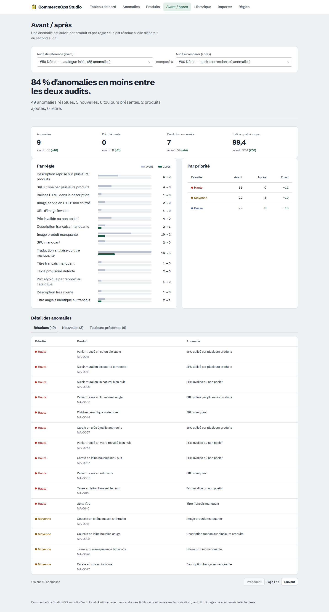

# Étude de cas — CommerceOps Studio

*Projet 1 de 3 du portfolio. Projet personnel réalisé sur des données fictives : ce n'est pas une mission client.*

## Le problème

Une boutique en ligne de quelques centaines de produits accumule vite des défauts invisibles : SKU recopiés d'une fiche à l'autre, prix à zéro après un import, photos manquantes, descriptions « modèle » collées partout, traductions oubliées. Chacun coûte des ventes (fiche peu convaincante), des erreurs logistiques (stock faux) ou de la visibilité (contenu dupliqué). Les agences et les responsables de boutique le constatent souvent fiche par fiche, sans vue d'ensemble ni priorités.

**Personas** (Lot 0) : la personne d'agence qui réalise l'audit et doit le restituer ; la personne de la boutique qui corrige les fiches.

## La solution

Un outil local qui transforme un export CSV en **plan de correction priorisé** :

1. **Import tolérant mais strict** : il accepte les formats réels (Excel FR : `;` et `29,95`), rejette ce qui est structurellement faux avec le numéro de ligne, et n'écrit rien en cas de rejet.
2. **19 règles explicites**, chacune avec un constat, une explication métier et une correction. Les règles statistiques ou textuelles sont étiquetées « À vérifier » : un prix dix fois supérieur à la médiane peut être une erreur de virgule… ou un miroir haut de gamme.
3. **Une vue qui dit quoi faire** : « 51 produits actifs sur 144 ont au moins une anomalie. 11 problèmes de priorité haute bloquent la vente ou la gestion du stock : commencez par là. »
4. **La preuve du progrès** : historique et comparaison avant / après, par produit et par règle.
5. **Des livrables** : CSV filtré pour l'équipe, PDF pour le client.

## Le résultat mesuré (données fictives)

| | Avant | Après |
|---|---:|---:|
| Anomalies | 55 | 9 |
| Priorité haute | 11 | 0 |
| Fiches actives sans anomalie | 65 % | 95 % |

Résultat obtenu par exécution réelle et vérifié par un test automatisé. C'est une démonstration de la méthode, pas un résultat client.

## Décisions que je peux défendre

- **Constat ou heuristique ?** Présenter « prix atypique » comme une erreur serait faux. Chaque règle déclare sa nature, que l'interface, les exports et le PDF affichent.
- **Choisir le bon indicateur.** La première version affichait l'indice moyen (95/100, « Très bon ») alors qu'un tiers des fiches avait un défaut : la moyenne est diluée par les fiches saines. La revue visuelle a fait apparaître cette contradiction. J'ai alors changé le barème (une anomalie haute fait tomber une fiche à 50) et mis en avant la part de fiches sans anomalie, un chiffre qu'on ne peut pas mal lire. Le changement de barème est versionné (`rules_version`) et la comparaison le signale.
- **Les brouillons ne sont ni bons ni mauvais.** Un test E2E a révélé que le filtre « sans anomalie » comptait les brouillons, qui ne sont pas audités. Je l'ai corrigé dans l'API et j'ai ajouté un test de non-régression.
- **Ne jamais appeler les URL du catalogue.** Vérifier qu'une image existe serait utile, mais cela ferait du serveur un client HTTP piloté par un fichier importé (risque de SSRF), et du navigateur un afficheur de pixels de suivi. Le contrôle reste structurel, et c'est documenté comme une limite.
- **Exports sûrs.** Une cellule `=HYPERLINK(...)` dans un titre importé devient du texte dans l'export (CWE-1236).
- **Résultats figés.** Un audit est un constat daté : les anomalies sont stockées avec la version des règles, pas recalculées.
- **Simplicité.** SQLite, SQL paramétré, graphiques en CSS, un seul processus : tout s'installe sous Windows sans privilèges ni service externe.

## Qualité démontrée

97 tests backend (dont un test positif et un test négatif par règle), 19 tests unitaires frontend, 10 parcours E2E dans Microsoft Edge (bureau et mobile) avec contrôle d'accessibilité axe-core WCAG A/AA en modes clair et sombre, Ruff, TypeScript strict, pip-audit et npm audit sans vulnérabilité, CI GitHub Actions.

## Compétences mobilisées

Python (FastAPI, Pydantic, SQLite), conception d'API REST documentée (OpenAPI), SQL, React et TypeScript, design d'interface et accessibilité, tests automatisés (pytest, Vitest, Playwright), sécurité applicative (validation d'entrées, injection CSV, CSP, journalisation sans données sensibles), connaissance métier e-commerce.

## Et ensuite

Variantes de produits ; métadonnées SEO (title, meta description) ; connecteur Shopify en lecture seule avec des scopes minimaux ; suggestions de réécriture par IA, toujours validées par un humain ; authentification si l'outil devient partagé.
